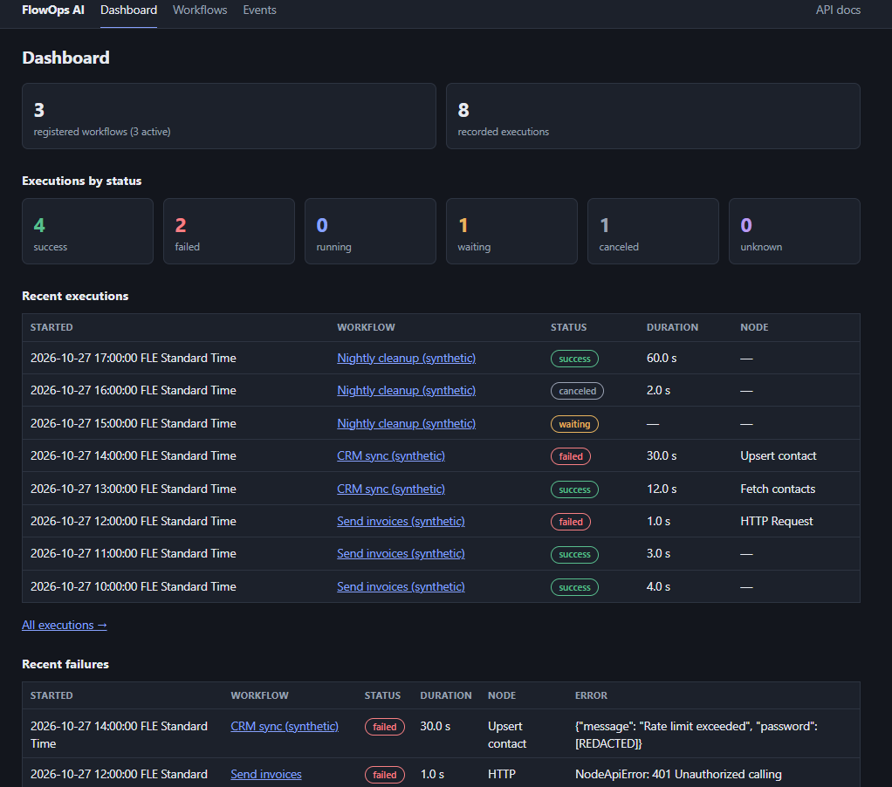
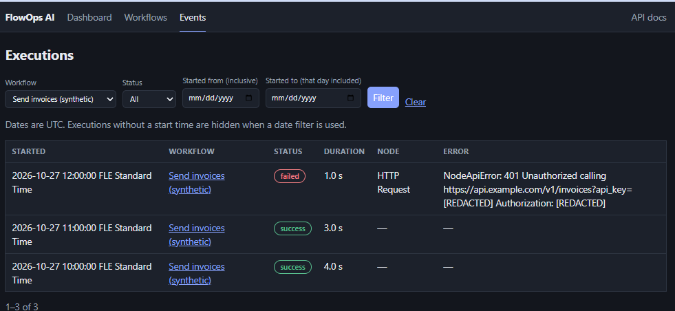
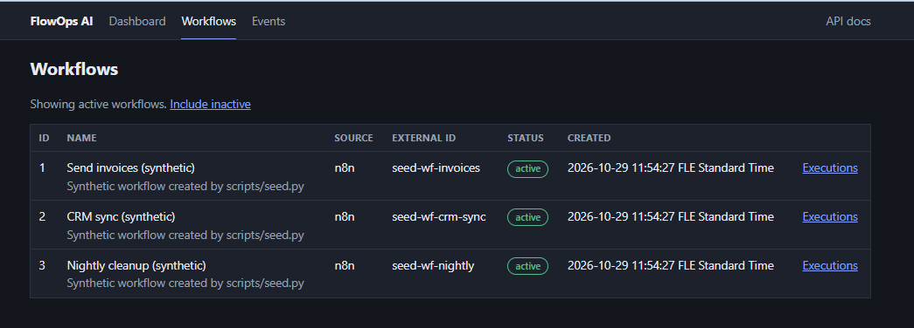

# FlowOps AI

**A small self-hosted dashboard that records automation runs (n8n first), so you can see what ran, what failed and why in one place.**

n8n tells you about a failure only if you go looking for it in its own execution list. FlowOps
keeps a separate, queryable history of runs with statuses, timings and sanitized error
messages. The longer-term goal is to have an LLM suggest troubleshooting steps for failures.

> **Status: V1 works locally; AI analysis is not built.** This is a learning and portfolio
> project, built one milestone at a time (M1-M6.5) with [Claude Code](https://claude.com/claude-code).
> It is not a production service, and it does **not** talk to a real n8n instance yet:
> today, events arrive through its own API (for example from the seed script).

## Screenshots

Synthetic data from `python -m scripts.seed`.







## What works today (V1)

- **Workflow registry.** REST CRUD for the automations you track (name, source, external id,
  description). Deleting is a *soft delete*: the workflow is deactivated and its history is kept.
  A deactivated workflow can be re-activated.
- **Event ingestion.** `POST /api/events` records one execution event.
  - **Token auth:** a shared secret in the `X-FlowOps-Token` header, compared with
    `secrets.compare_digest`. The app refuses to start if no token is configured.
  - **Upsert, not just dedup:** events are keyed on `external_event_id`. A `running` event that
    later arrives as `success`, `failed` or `canceled` updates the same row; a finished event is
    never overwritten; an event without an id is always inserted.
  - **Error sanitizing:** the raw error text is stored as received but never returned or
    rendered. Only a redacted, length-capped `error_summary` is shown.
- **Querying.** `GET /api/events` filters by workflow, status and date range, with limit/offset
  paging and a total count. Date bounds are UTC, `from` is inclusive and `to` is exclusive (a bare
  `to` date covers that whole day).
- **Dashboard.** Server-rendered Jinja2 pages: counts by status, recent executions, recent
  failures, a workflows list and a filterable, paged events list, with empty states for a fresh install.
- **Observability.** One log format (readable text or JSON lines, UTC times) with the level from
  `LOG_LEVEL`. Every request gets an `X-Request-ID` (reused from the caller if it sends a
  well-formed one, so a single event can be traced end to end) that appears on every log line
  for that request and in the response header. Unexpected errors are logged once with the full
  traceback, while the client gets a clean `500` JSON body with the request id; no stack trace.
- **n8n pull sync.** `python -m scripts.sync_n8n` reads the executions of the n8n workflows you
  registered and feeds them through the same upsert. It is read-only towards n8n (GET requests
  only), asks for execution *data* only for failed runs, and keeps just the error's name,
  message, stack and failing node name, never the run data. Developed against recorded (scrubbed)
  n8n responses; see "Syncing from n8n" below.
- **Tests.** 438 pytest tests. Each test gets its own fresh SQLite file, so they are
  order-independent.

**Not built yet:** push from n8n, a scheduler inside the app, LLM analysis, LangGraph, dashboard
login, HTTPS, migrations, metrics.

## Tech stack, and why

| Piece | Why |
|---|---|
| **Python 3.12 + FastAPI** | Type-hint-driven validation, and interactive API docs for free at `/docs`. |
| **Pydantic** | Separate input and output schemas, so the API never returns a raw database object. |
| **SQLAlchemy 2.0 + SQLite** | Zero setup for a local project. Sync sessions and plain `def` routes keep it simple; SQL stays portable so PostgreSQL remains an option. |
| **Jinja2** | A server-rendered dashboard needs no JavaScript build step, and its autoescaping is a safety net for user-supplied text. |
| **pytest + httpx2** | Fast API tests against a real SQLite file per test. |
| **python-dotenv** | Secrets and settings live in a git-ignored `.env`. |

No frontend framework, Docker, Redis, Celery or vector database, on purpose: the project is
small enough not to need them.

## Setup and run (Windows PowerShell)

Requires Python 3.12.

```powershell
python -m venv venv
.\venv\Scripts\Activate.ps1
pip install -r requirements.txt
copy .env.example .env
```

Then open `.env` and set `FLOWOPS_INGEST_TOKEN` (required). To generate a value:

```powershell
python -c "import secrets; print(secrets.token_urlsafe(32))"
```

Start the app. It creates any missing database tables on startup:

```powershell
python -m uvicorn app.main:app --reload
```

- Dashboard: http://localhost:8000/ (also `/workflows` and `/events`)
- API docs: http://localhost:8000/docs
- Health check: http://localhost:8000/health

With the app running, in a second terminal, load synthetic data (safe to repeat):

```powershell
python -m scripts.seed
```

Run the tests:

```powershell
python -m pytest
```

To wipe the database and start over (**deletes all data**; stop the app first):

```powershell
python -m scripts.reset_db --yes
```

### Try the API

After seeding, workflow `1` exists. Send an event (replace the token with yours):

```powershell
$body = @{ workflow_id = 1; external_event_id = "demo-1"; status = "running"; started_at = "2026-10-27T09:00:00Z" } | ConvertTo-Json
Invoke-RestMethod -Method Post -Uri http://localhost:8000/api/events `
  -Headers @{ "X-FlowOps-Token" = "<your token>" } -ContentType "application/json" -Body $body
```

Sending the same `external_event_id` again with `status = "success"` and a `finished_at` updates
that row in place (`"result": "updated"`).

### Syncing from n8n

1. In `.env`, set `N8N_BASE_URL` (for example `https://your-n8n-host`) and `N8N_API_KEY` (an n8n
   API key; create it in n8n under Settings, API). The URL must be `https` unless it is localhost.
2. Register each n8n workflow you want tracked, with its n8n id as `external_id` and `source`
   `n8n` (the pair must be unique; a duplicate gets a 409):

```powershell
$body = @{ name = "My workflow"; source = "n8n"; external_id = "<the workflow id from n8n's URL>" } | ConvertTo-Json
Invoke-RestMethod -Method Post -Uri http://localhost:8000/api/workflows -ContentType "application/json" -Body $body
```

3. Run the sync (the app does not need to be running):

```powershell
python -m scripts.sync_n8n              # one run
python -m scripts.sync_n8n --loop 300   # repeat every 5 minutes (Ctrl+C to stop)
```

Each run prints per-workflow counts (created / updated / unchanged / skipped), warnings, and the
active n8n workflows that are not registered in FlowOps (they are reported, never imported). For
unattended runs, schedule the one-shot command with Windows Task Scheduler every 5 minutes.

Things to know:
- The first run imports everything n8n still has. n8n prunes old executions (by default after 14
  days or 10,000 executions), so FlowOps can only recover what n8n still holds; if a run finds
  that executions were pruned since the last one, it warns about a "possible gap".
- Unfinished executions are re-checked on later runs: for 24 hours (running/unknown) or 30 days
  (waiting).
- It warns when a workflow's settings tell n8n not to save executions, because then there is
  nothing to sync.
- Exit codes: 0 ok, 1 n8n unreachable or rejected the key, 2 configuration problem.

### Configuration

| Variable | Default | Purpose |
|---|---|---|
| `FLOWOPS_INGEST_TOKEN` | *(required)* | Shared secret for `POST /api/events`; the app will not start without it |
| `N8N_BASE_URL` | *(sync only)* | Your n8n address, `https` unless localhost |
| `N8N_API_KEY` | *(sync only)* | n8n API key; sent only to that address, never logged |
| `DATABASE_URL` | `flowops.db` in the repo root | SQLite database |
| `APP_NAME` | `FlowOps AI` | App title in `/docs` |
| `LOG_LEVEL` | `INFO` | `DEBUG`, `INFO`, `WARNING`, `ERROR` or `CRITICAL`; an invalid value stops startup |
| `LOG_FORMAT` | `text` | `text` (readable) or `json` (one object per line) |
| `FLOWOPS_BASE_URL` | `http://localhost:8000` | Only used by `scripts.seed` |

## Design decisions

- **Upsert for events.** n8n reports a run as "running" and later as finished. Plain
  de-duplication would leave every execution stuck in `running`, so a non-finished event may be
  completed exactly once, and a finished one is final.
- **Raw errors are never shown.** Error payloads can contain tokens and personal data. They are
  stored as received but have no field in any API response or template; only the redacted summary
  does. The redaction is best-effort (it covers obvious patterns like bearer tokens, API keys and
  passwords) and is not a guarantee, which is why the raw text is never exposed at all.
- **UTC everywhere in storage.** Timestamps are stored as naive UTC, returned by the API with
  an explicit `Z`, and converted to local time only for display in the dashboard.
- **Throwaway database in V1.** There are no migrations. Any schema change means deleting the
  database and re-seeding (`reset_db`). Alembic is planned for a later phase, once there is data
  worth keeping. Startup only creates missing tables; it never alters or drops anything.
- **Localhost-only, no login on the dashboard.** This is a deliberate V1 assumption, not an
  oversight. Writing events needs the token, but reading the dashboard and `GET /api/events` does
  not. Before this is exposed to a network, the dashboard needs authentication and HTTPS.
- **Pull, not push, for n8n.** The first idea was to use both channels: pull from n8n's REST API
  for completeness and push from its Error Trigger for fast failure alerts. I argued against it
  and chose pull only. Push alone could not feed a dashboard (the Error Trigger fires only on
  failures, so success counts would be missing), and FlowOps has no alerting that would use the
  extra speed. Push would also need FlowOps reachable from outside, which breaks the
  localhost-only assumption, and a push to a laptop that is asleep is lost, while a pull simply
  catches up. Push stays deferred, with written conditions for reconsidering it.
- **The failing node comes only from the error itself.** n8n also reports the last node that
  ran, but that is not necessarily the node that failed, so it is never used. If n8n gives no
  node, the field stays empty rather than being filled with a guess.
- **Minimal data from n8n.** Execution data can hold customer data, so it is requested only for
  failed runs and only the error's own fields are kept; everything else is discarded unread.

## Roadmap (planned, none of this exists yet)

- **n8n integration, next steps:** show detected gaps and unmonitored workflows on the dashboard,
  and flag workflows that went quiet. Push stays deferred unless alerting is added.
- **V2 - AI incident analysis:** send a failure's sanitized context to an LLM and get structured
  troubleshooting suggestions back. This needs a deliberately varied set of synthetic failures to
  evaluate against, since real failures will be few and similar.
- **V3 - LangGraph:** multi-step incident analysis with conditional routing, state and a human
  approval step.
- **Hardening:** migrations (Alembic), dashboard authentication and HTTPS before any deployment.

## Project layout

```
app/
  main.py        FastAPI app, startup (token check, table creation)
  config.py      settings from environment variables
  database.py    engine, sessions, SQLite settings, UTC datetime type
  models.py      Workflow, ExecutionEvent, ExecutionStatus
  schemas.py     Pydantic input/output models
  auth.py        ingest token check
  logging_config.py  log format, level, request id on every record
  middleware.py  request id, access log, catch-all error handler
  sanitize.py    error text redaction
  timeutil.py    UTC helpers, duration, date-bound parsing
  n8n_client.py  read-only (GET-only) n8n API client
  routers/       thin HTTP routes (API and HTML pages)
  services/      all database logic; n8n_sync.py is the pull sync
  templates/     Jinja2 templates
scripts/         reset_db.py, seed.py, sync_n8n.py
tests/           pytest suite (fresh database per test)
screenshots/     images used in this README
```

`CLAUDE.md` records the project's conventions (timestamp handling, sync sessions, database
portability) for the AI assistant used to build it.
