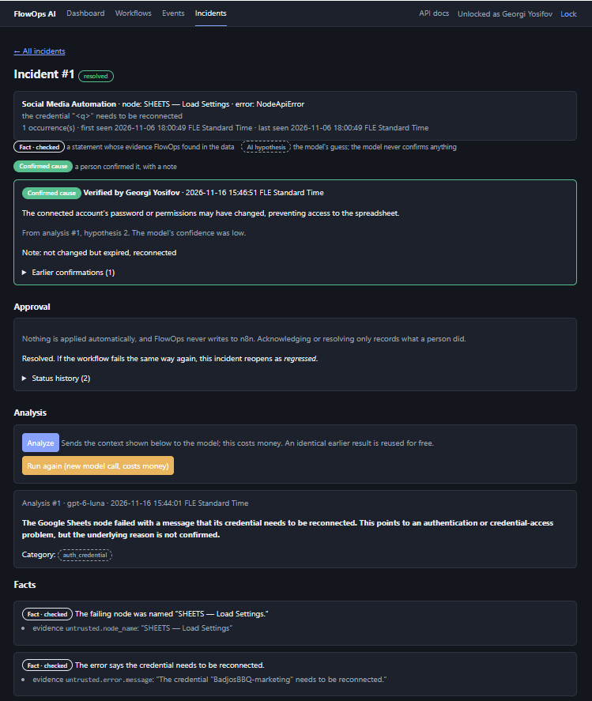

# FlowOps AI

**A local monitor for n8n automations: it pulls execution history, groups failures into incidents, asks an LLM for *hypotheses* about the cause, and keeps a human in charge of what counts as confirmed.**

n8n shows a failure only if you open its execution list, and a flaky workflow produces the same
error dozens of times. FlowOps keeps its own queryable history of runs, groups repeated failures
into one incident, and can ask a model to suggest what went wrong. The interesting part is not the
model call; it is how little the model is trusted. Nothing it says is called a fact or a cause
unless the server can check it against the data that was sent, and nothing is called *verified*
unless a person confirms it.

> **Status: complete (V1 + V2).** A personal learning and portfolio project, built one milestone
> at a time with [Claude Code](https://claude.com/claude-code). It runs on localhost only and is
> **not deployed**; see [Roadmap](#roadmap-and-what-is-not-built) for what deployment would need.

## Screenshots

Dashboard, with the open-incidents card and recent executions:


An incident: occurrences, the analysis split into facts and hypotheses, and the approval controls:



## What it does

- **Read-only pull-sync of n8n.** `python -m scripts.sync_n8n` reads the execution history of the
  n8n workflows you registered and feeds it through the same upsert as the API. The n8n client has
  only GET methods (a test asserts it cannot write), requires `https` unless the host is
  localhost, and never follows redirects.
- **Incidents with deterministic signatures.** Failed executions that share a cause are grouped:
  the signature is a hash of workflow, failing node, error name and a *normalized* message (numbers,
  ids, URLs, e-mails and timestamps replaced by placeholders). No model is involved in grouping.
  Counts and first/last seen are computed by query, never stored, so they cannot drift from the events.
- **OpenAI incident analysis, on demand only.** One button (or one API call) sends a scrubbed
  context to the model and stores a structured, checked answer. It never runs automatically, and
  it costs money (a fraction of a cent per analysis on the default model).
- **Human approval workflow.** `open → acknowledged → resolved`; a new failure after a resolve
  makes the incident `regressed`. A person can confirm one hypothesis with a note. Everything is
  recorded in insert-only history. Nothing auto-applies.
- **Server-rendered UI with session auth.** Jinja2 pages, no JavaScript: dashboard, workflows,
  events, an incident list and an incident detail page. Reading is open; every action needs an
  unlocked session.
- **Plus the V1 basics:** workflow registry with soft delete, token-protected event ingestion with
  upsert (a `running` event can later become `success`/`failed`, a finished one is final), event
  queries with date filters and paging, structured logs with a request id on every line.

## Design decisions

### 1. Anti-hallucination by construction

An LLM will sound confident about a cause it cannot see (FlowOps cannot see your credentials or the
remote system). So the design makes certainty impossible to express rather than asking nicely:

- **The output schema has no way to claim a verified cause.** There is no `verified`, `root_cause`
  or action field. A cause can only be a *hypothesis*, with a categorical confidence
  (`low | medium | high`, never a percentage) and a list of things a human could check to confirm it.
  A test scans the generated schemas for those words.
- **Every piece of evidence is checked on the server.** Each fact and hypothesis cites evidence as
  `{ref, quote}`: `ref` is a dotted path to one value in the context that was actually sent, and
  `quote` must appear in that value (at least 8 characters, or the whole value, so `"a"` proves
  nothing). A fact without a valid citation is removed. A hypothesis without one is kept but marked
  `unsupported`, and the UI shows it.
- **A deterministic confidence ceiling.** `high` needs at least two valid evidence items with
  distinct refs; otherwise it is lowered to `medium` and a note records why. At most three
  hypotheses are kept.
- **"Verified" exists in exactly one place: a person confirming a cause.** The confirmation stores
  who, when, a required note, and points at one hypothesis of one stored analysis. The UI shows
  three clearly different things: `Fact · checked`, `AI hypothesis` (with confidence), and
  `Confirmed cause`. A test removes the confirmed-cause box from every page and asserts the word
  "verified" appears nowhere else. Server-checked model output is called *checked*, never *verified*.
- **Append-only history.** Analyses, status changes and confirmations are only ever inserted. A
  repeat analysis of an unchanged context is returned from the stored result (no model call);
  failed attempts are stored too.
- **An opt-in eval harness** (`python -m scripts.eval_analysis`) runs the model over 30 labelled
  synthetic failures in 20 groups, including trap cases where the right answer is "not enough
  evidence". By default it only prints a cost quote and sends nothing.

What this does *not* do: the check proves a quote is really in the data, not that the model's
conclusion is true. Hypotheses are guesses; that is why a person confirms them.

#### Evaluation

I ran `python -m scripts.eval_analysis --yes` once over the hand-labelled synthetic corpus (20
incidents, one per group):

| Measure | Result |
|---|---|
| Category accuracy | 100% |
| Trap cases failed | 0 |
| Facts removed by verification | 0% (every cited `{ref, quote}` resolved to real context) |
| Total run cost | $0.0107 |

How to read this: the corpus is **synthetic and written by me**, so it tests whether the guardrails
hold on designed cases, including traps built to tempt an overconfident or fabricated cause (a trap
passes only if the model reports insufficient evidence and claims no `high`-confidence hypothesis).
It is **not** a measure of accuracy on real failures. A perfect score on 20 designed cases is a
sanity check that the construction works, not a claim that the model is always right.

### 2. Prompt-injection defence

Error messages are third-party text and can say "ignore previous instructions". The context is
split into `trusted` (computed by FlowOps: ids, counts, enums, timestamps, no free text) and
`untrusted` (names and error text, scrubbed). It is wrapped in `<untrusted_incident_data>`, with
`<`, `>` and `&` written as `\uXXXX` inside, so error text cannot close or open the tag. The system
prompt says the block is data and never instructions, and, most importantly, the output schema gives
the model no action to take. There is a test that feeds a hostile error message through.

### 3. Data minimisation and sanitization

- **Pulled from n8n:** the list call never asks for execution data; data is requested only for
  failed runs, one at a time, and only an allow-list is kept (error name, message, description, HTTP
  code, stack, and the failing node's *name*). The rest of the node object (it can carry credentials
  and parameters) and all run data are discarded unread.
- **Sent to the model:** a further allow-listed projection (message, description, HTTP code, at most
  15 stack lines), passed through secret redaction and a PII scrub (e-mails, URL credentials and
  query strings, card/IBAN/long digit runs, phone numbers). The call uses `store=False`, so OpenAI
  does not retain the response. `GET /api/incidents/{id}/context` previews exactly what would be sent.
- **Shown to you:** the raw error text is stored as received but has no field in any response schema
  and is never rendered. Pages show only a redacted, capped `error_summary`.
- **Honest limit:** scrubbing is best-effort. Personal *names* and street addresses are not caught;
  minimisation (not sending run data at all) is the real control.

### 4. Read-only, pull-only n8n integration

FlowOps never writes to n8n and suggests actions only as text for a person. It pulls rather than
being pushed to: a failure-only push (n8n's Error Trigger) could not feed success counts, would need
FlowOps reachable from outside, and loses events when the laptop is asleep, while a pull just
catches up. Late finishers are handled with a 24-hour overlap window, and executions n8n has pruned
are reported as a possible gap. The failing node is taken only from the error itself, never from "last
node executed", and stays empty when n8n does not say.

### 5. CSRF on localhost, with no JavaScript and no new dependency

The API authenticates with an `X-FlowOps-Token` header, which a plain HTML form cannot send. The
pages therefore use a short session: `/unlock` checks the token once (constant-time) and sets an
HMAC-signed cookie (HttpOnly, SameSite=Strict, 12 h) that contains a name and a nonce, never the
token. The signing key is derived from the token, so rotating the token logs everyone out.

SameSite alone is not enough here: browsers treat every port on `localhost` as the *same site*, so
another local web app could post with the cookie. Every action POST therefore also passes a
per-session CSRF token and an Origin/Host check (Host must be `localhost`, `127.0.0.1` or `[::1]`,
and Origin must be exactly this site, which also blocks DNS rebinding). Forms are parsed with the
standard library, capped at 16 KB. The recorded actor comes from the session, never from a form
field. The session code and its tests are in `app/ui_auth.py`, `tests/test_ui_auth.py`.

### Smaller decisions

- **Timestamps are naive UTC in the database**, `Z`-suffixed in the API, local time only for display.
- **Sync SQLAlchemy and plain `def` routes**, and portable SQL only, so PostgreSQL stays possible.
- **Throwaway database for now:** no migrations; a schema change means `reset_db`. Startup only
  creates missing tables.
- **Analyzer behind a small interface**, with a fake in tests. The test suite never constructs an
  OpenAI client (a fixture makes that raise) and needs no key.

## Tech stack

| Piece | Used for |
|---|---|
| Python 3.12, FastAPI, Uvicorn | API and pages; interactive docs at `/docs` |
| Pydantic | Separate input/output schemas; strict structured output from the model |
| SQLAlchemy 2.0 + SQLite | Sync sessions, WAL, CHECK constraints on every status column |
| Jinja2 | Server-rendered pages with autoescaping; no JS, no static files |
| OpenAI Python SDK (`responses.parse`) | Structured incident analysis; default model `gpt-6-luna`, configurable |
| `httpx2` | The read-only n8n client |
| Standard library | Session cookies (`hmac`, `hashlib`), form parsing, hashing |
| pytest | **1100 tests**, a fresh SQLite file per test; no network access |

Dependencies are pinned in `requirements.txt` (`openai` also brings `jiter` and `sniffio`). No
frontend framework, Docker, Redis, Celery, vector database, LangChain or LangGraph.

## Setup and run (Windows PowerShell)

Requires Python 3.12.

```powershell
python -m venv venv
.\venv\Scripts\Activate.ps1
pip install -r requirements.txt
copy .env.example .env
```

Edit `.env`:

| Variable | Needed for | Notes |
|---|---|---|
| `FLOWOPS_INGEST_TOKEN` | **always** | The app will not start without it. Also the password for `/unlock`. Generate: `python -c "import secrets; print(secrets.token_urlsafe(32))"` |
| `N8N_BASE_URL`, `N8N_API_KEY` | `scripts.sync_n8n` | `https` unless localhost. Create the key in n8n under Settings, API |
| `OPENAI_API_KEY` | Analyze only | The app starts without it; analysis then says it is unavailable |
| `OPENAI_MODEL`, `OPENAI_REASONING_EFFORT`, `OPENAI_MAX_OUTPUT_TOKENS`, `OPENAI_TIMEOUT_SECONDS` | optional | Defaults in `.env.example`; a bad value stops startup |
| `DATABASE_URL`, `APP_NAME`, `LOG_LEVEL`, `LOG_FORMAT` | optional | SQLite file in the repo root by default |

Start the app (it creates any missing tables):

```powershell
python -m uvicorn app.main:app --reload
```

Dashboard at http://localhost:8000/, API docs at http://localhost:8000/docs.

**Without n8n**, load synthetic workflows and events (app running; safe to repeat). Its failures
form incidents:

```powershell
python -m scripts.seed
```

**With n8n:** register each workflow you want tracked, using its n8n id as `external_id`, then sync
(the app does not need to be running for the sync):

```powershell
$body = @{ name = "My workflow"; source = "n8n"; external_id = "<id from the n8n URL>" } | ConvertTo-Json
Invoke-RestMethod -Method Post -Uri http://localhost:8000/api/workflows -ContentType "application/json" -Body $body

python -m scripts.sync_n8n              # one run
python -m scripts.sync_n8n --loop 300   # repeat every 5 minutes
```

The sync prints per-workflow counts and warnings (possible gaps, unregistered n8n workflows). It
exits 0 on success, 1 if n8n is unreachable or rejects the key, 2 on a configuration problem.
n8n prunes old executions, so only what it still holds can be imported.

**Using the incident pages:** open http://localhost:8000/incidents. To act, go to `/unlock` and enter
the token and your name (recorded as the actor). Then you can acknowledge, resolve, **Analyze**
(a paid model call, only when you click), and confirm a hypothesis with a note.

Other commands:

```powershell
python -m pytest                          # the test suite
python -m scripts.rebuild_incidents       # regroup after a signature-rule change (idempotent)
python -m scripts.eval_analysis           # quote the cost of the analysis eval; sends nothing
python -m scripts.eval_analysis --yes     # really calls OpenAI and spends money
python -m scripts.reset_db --yes          # DELETES the database; stop the app first
```

A schema change (for example after pulling a new milestone) needs `reset_db`; then re-register your
workflows, re-sync and re-analyze.

## Architecture

```
n8n (read-only GET) ─► sync ─┐
POST /api/events ────────────┴─► ingest ─► group ─► context ─► analyze ─► approve ─► UI
                                 upsert    incident   scrubbed   model +     human      Jinja2
                                 + sanitize signature  allow-list server      confirms   pages
                                                       + frame    checks
```

- **Ingest:** `routers/events.py` → `services/events.py`. Upsert on the external event id, error
  sanitizing, then incident assignment in the same transaction.
- **Group:** `signature.py` (pure) and `services/incidents.py`. A failure after a resolve flips the
  incident to `regressed` in that same transaction.
- **Context:** `services/incident_context.py` builds exactly what a model would be sent, with its hash.
- **Analyze:** `app/analysis/` (`prompt`, `schema`, `verify`, `analyzer`) and `services/analysis.py`.
  `analyzer.py` is the only module that imports `openai`.
- **Approve:** `services/approval.py`: transitions, regression history, cause confirmations.
- **UI:** `routers/pages.py`, `services/incident_views.py`, `ui_auth.py`, `templates/`.

API (JSON): `/api/workflows`, `/api/events`, and `/api/incidents` with `/{id}`, `/{id}/context`,
`/{id}/analyze`, `/{id}/analyses`, `/{id}/transitions`, `/{id}/confirmations`. Writes need the
`X-FlowOps-Token` header; reads are open. Full details are in `/docs`.

## Roadmap and what is not built

This is a finished V1 + V2, not a production service.

- **Deployment is not done and would need work first.** HTTPS (the session cookie is deliberately not
  `Secure` because V1 is plain http on localhost); a `Secure` cookie; Starlette `TrustedHostMiddleware`
  so reads are not exposed to DNS rebinding; rate limiting on `/unlock`; and real user identity
  (today the "actor" is a self-declared name, and the token proves access, not who you are). Sessions
  are stateless, so a stolen cookie works until it expires or the token is rotated. Reads are open by
  design in V1.
- **Migrations (Alembic)** are not set up. The database is throwaway for now.
- **Known small limit:** two simultaneous Analyze requests can both call the model.
- **Not built:** push from n8n, a scheduler inside the app (the sync is run by hand or by Task
  Scheduler), alerting, and metrics. The eval above is one run on a synthetic corpus, not a benchmark.
- **LangGraph (V3)** is a possible learning extension (multi-step diagnosis with read-only tools),
  not part of what this project delivers.

## Repository layout

```
app/
  analysis/      prompt, output schema, server-side verification, OpenAI adapter
  routers/       thin HTTP routes: workflows, events, incidents (JSON) and pages (HTML)
  services/      all database logic, incident grouping, context, analysis, approval, n8n sync
  templates/     Jinja2 pages (inline CSS, no JS)
  signature.py   incident signature + message normalization (pure)
  sanitize.py    secret redaction and PII scrubbing
  ui_auth.py     unlock session, CSRF, Origin/Host check
  n8n_client.py  read-only n8n API client
scripts/         seed, sync_n8n, rebuild_incidents, eval_analysis, reset_db
tests/           pytest suite, scrubbed n8n fixtures, a labelled incident corpus
screenshots/     images used in this README
```

`CLAUDE.md` records the project's conventions for the AI assistant used to build it.


## License

MIT — see [LICENSE](LICENSE).